# Лабораторная работа №1 (10). Слив гидроаккумулятора под давлением азотной подушки
## Выполнили: Гребенников Е., Михайлова Д., Петриякин М. 

## 1. Цель работы
Собрать в КОРСАР расчетную схему, моделирующую слив воды из гидроаккумулятора под давлением азотной подушки. Получить зависимости массового расхода воды и давления от времени. При снижении объема воды до 5% полного объема сосуда прекратить истечение закрытием VAL. Сравнить результаты с аналитическими зависимостями для изотермического и адиабатического расширения газовой подушки.  

### Навыки, приобретаемые по результатам выполнения работы
> - задание SLVES в режиме гидроаккумулятора с азотом, начальным уровнем и температурой
> - задание гидравлического сопротивления VAL и однократного закрытия по уровню в EVENT
> - вывод модели слива из дифференциальных законов сохранения массы, импульса и энергии 
> - разделение влияния гидравлического сопротивления, теплообмена газовой подушки и численных настроек
---
## 2. Описание постановки задачи
Вертикальный цилиндрический сосуд частично заполнен водой. Над водой находится азотная подушка; начальное давление над уровнем P0=1 МПа, начальная температура воды и газа Т0=45°C. Через нижний патрубок вода поступает в сливной канал CH и далее в приемник BVOL_T с постоянным давлением Pb=0.5 МПа. Все давления абсолютные. В одном из соединений CH установлен VAL, который в открытом положении представляет постоянное сопротивление шайбы, а при достижении уставки уровня закрывается.\
Параметры задачи представлены в таблице
|Параметр|Значение|
---|:---:|
|Полный объем сосуда|1.000 м³|
|Высота сосуда|2.000 м|
|Начальный объем воды|0.350 м³|
|Начальный объем газовой подушки|0.650 м³|
|Начальный уровень|0.700 м|
|Объем воды при закрытии|0.050 м³|
|Уровень при закрытии|0.100 м|
|Объем газа при закрытии |0.950 м³|
|Сливаемый объем воды|0.300 м³|
|Начальное давление над уровнем|1 МПа|
|Давление приемника |0.5 МПа|
|Начальные температуры воды и газа|318.15 К|
|Температура жидкости BVOL_T|318.15 К|
|Газовая постоянная азота|296.8 Дж/(кг·К)|
|Показатель адиабаты|1.4, постоянный|
|Длина CH|1.000 м|
|Внутренний диаметр CH|0.040 м|
|Основное разбиение CH|10 ячеек|
|Полное эквивалентное сопротивление|~8780|
---
## 3. Требуемые результаты
- нодализация, исходные данные, настройки состава газовой подушки и листинг логики отсечки
- вывод зависимостей из законов сохранения, скрипт решения и контрольная таблица для двух показателей n
- графики расхода, давления, уровня и температуры газа от времени для КОРСАР и двух аналитических режимов
- таблицы времени слива, массы слитой воды, давления перед закрытием, остаточного уровня и невязок баланса
- исследование сетки, шага времени и влияния теплообмена; объяснение различий с изотермой и адиабатой
---
## 4. Ход выполнения работы
Для выполнения задачи были созданы файлы задачи kordat и обработки данных kutdat. Нодализация задачи представлена на рисунке

Вода несжимаема, ее плотность постоянна; газ идеален, однороден по температуре и давлению, его масса постоянна. Испарение, растворение и унос азота в аналитике отсутствуют, сосуд жесткий.

---
## 5. Получение результатов работы
### 5.1 Вывод зависимостей из законов сохранения
Уравнение для расхода (стационарный вариант)\
$P_0 = -\rho g h_0 + \dfrac{\rho \bar{w}^2}{2} + P_b + \Delta P$ 

$\Delta P = \dfrac{\lambda l \rho \bar{w}^2}{2d} + \dfrac{\xi \rho \bar{w}^2}{2}$

$P_0 + \rho g h_0 - P_b = \dfrac{\rho \bar{w}^2}{2}\left(1 + \lambda \dfrac{l}{d} + \xi\right)$

$\bar{w}$= $\sqrt{\dfrac{2(P_0 + \rho g h_0 - P_b)}{\rho\left(1 + \lambda \dfrac{l}{d} + \xi\right)}}$

$G = F_{прох} \sqrt{\dfrac{2\rho(P_0 + \rho g h_0 - P_b)}{1 + \lambda \dfrac{l}{d} + \xi}}$

Уравнение для расхода (нестационарный вариант)\
$G(\tau) = F_{\text{прох}} \sqrt{\dfrac{2\rho\left(P(\tau) + \rho g z(\tau) - P_b\right)}{1 + \lambda \dfrac{l}{d} + \xi}}$

Изменение уровня воды\
$\dfrac{dV}{d\tau} = \dfrac{G(\tau)}{\rho}$

$dV = F_{\text{сосуд}} \, dz$

$\dfrac{dz}{d\tau} = -\dfrac{G(\tau)}{F_{\text{сосуд}} \, \rho}$

Уравнение состояния идеального газа\
$\dfrac{d\left(P(\tau) V_г(\tau)\right)}{d\tau} = \dfrac{d\left(m R T_г(\tau)\right)}{d\tau}$

$\dfrac{dP}{d\tau}\cdot V_г(\tau) + P(\tau)\cdot \dfrac{dV_г}{d\tau} = m R \cdot\dfrac{dT_г}{d\tau} \quad \Big|\; : V_г(\tau)$

$\dfrac{dP}{d\tau} + \dfrac{P(\tau)}{V_г(\tau)} \cdot \dfrac{G(\tau)}{\rho} = \dfrac{m R}{V_г(\tau)} \cdot \dfrac{dT_г}{d\tau}$

$V_(\tau) = F_{\text{сосуд}} \left(H - z(\tau)\right)$

$\dfrac{dP}{d\tau} - \dfrac{P(\tau)}{H - z(\tau)} \cdot \dfrac{dz}{d\tau} = \dfrac{m R}{F_{\text{сосуд}}\cdot (H - z(\tau))} \cdot \dfrac{dT_г}{d\tau}$

Уравнение политропы\
$PV = mRT \Rightarrow V = \dfrac{mRT}{P}$

$PV^n = \text{const}$

$P_0 \cdot\left(\dfrac{mRT_0}{P_0}\right)^n = P(\tau) \cdot \left(\dfrac{mRT_г(\tau)}{P(\tau)}\right)^n$

$T_0^n \cdot P_0^{1-n} = T_г(\tau)^n \cdot P(\tau)^{1-n}$

$T_г(\tau) = T_0 \cdot \left(\dfrac{P_0}{P(\tau)}\right)^{\frac{1-n}{n}} \Rightarrow \; T_г(\tau) = T_0 \cdot\left(\dfrac{P(\tau)}{P_0}\right)^{\frac{n-1}{n}} \quad$

Итоговая система в общем случе
$$\begin{cases}
G(\tau) = F_{\text{прох}} \sqrt{\dfrac{2\rho\left(P(\tau) + \rho g z(\tau) - P_b\right)}{1 + \lambda \dfrac{l}{d} + \xi}} \\[12pt]
\dfrac{dz}{d\tau} = -\dfrac{G(\tau)}{F_{\text{сосуд}} \, \rho} \\[12pt]
\dfrac{dP}{d\tau} - \dfrac{P(\tau)}{H - z(\tau)} \cdot \dfrac{dz}{d\tau} = \dfrac{m R}{F_{\text{сеч}} (H - z(\tau))} \cdot\dfrac{dT_г}{d\tau} \\[12pt]
T_г(\tau) = T_0 \cdot \left(\dfrac{P(\tau)}{P_0}\right)^{\frac{n-1}{n}}
\end{cases} $$

Изотермический процесс ($n = 1$)
$$\begin{cases}
G(\tau) = F_{\text{прох}} \sqrt{\dfrac{2\rho(P(\tau) + \rho g z(\tau) - P_b)}{1 + \lambda \dfrac{l}{d} + \xi}} \\[10pt]
\dfrac{dz}{d\tau} = -\dfrac{G(\tau)}{F_{\text{сосуд}} \rho} \\[10pt]
\dfrac{dP}{d\tau} - \dfrac{P(\tau)}{H - z(\tau)} \cdot \dfrac{dz}{d\tau} = 0 \\[10pt]
T_г(\tau) = T_0
\end{cases}$$

Адиабатический процесс ($n = \gamma = 1{,}4$)
$$\begin{cases}
G(\tau) = F_{\text{прох}} \sqrt{\dfrac{2\rho\left(P(\tau) + \rho g z(\tau) - P_b\right)}{1 + \lambda \dfrac{l}{d} + \xi}} \\[12pt]
\dfrac{dz}{d\tau} = -\dfrac{G(\tau)}{F_{\text{сосуд}} \, \rho} \\[12pt]
\dfrac{dP}{d\tau} - \dfrac{P(\tau)}{H - z(\tau)} \cdot \dfrac{dz}{d\tau} = \dfrac{m R}{F_{\text{сосуд}} (H - z(\tau))} \cdot \dfrac{dT_г}{d\tau} \\[12pt]
T_г(\tau) = T_0 \cdot \left(\dfrac{P(\tau)}{P_0}\right)^{\frac{\gamma - 1}{\gamma}}
\end{cases}$$

### 5.2 Результат обработки данных из КОРСАРа и двух аналитических режимов
#### Результат из КОРСАР
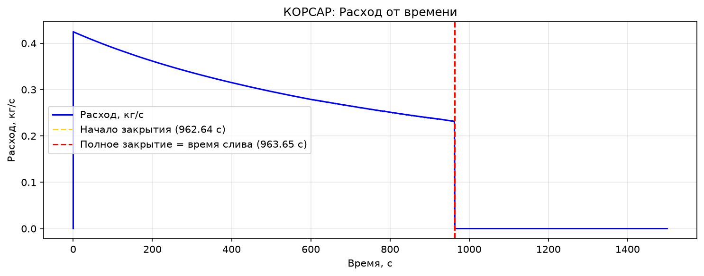

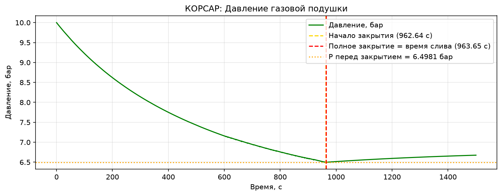

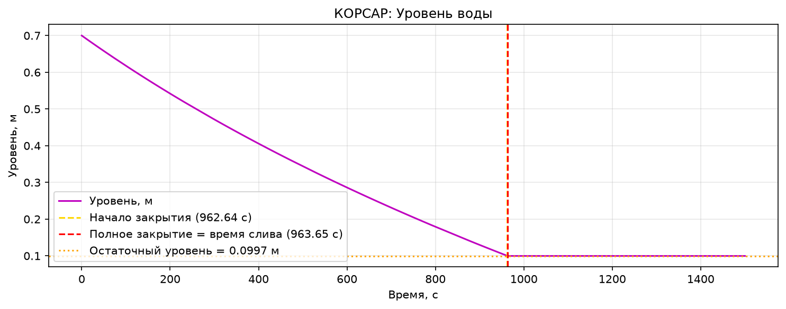

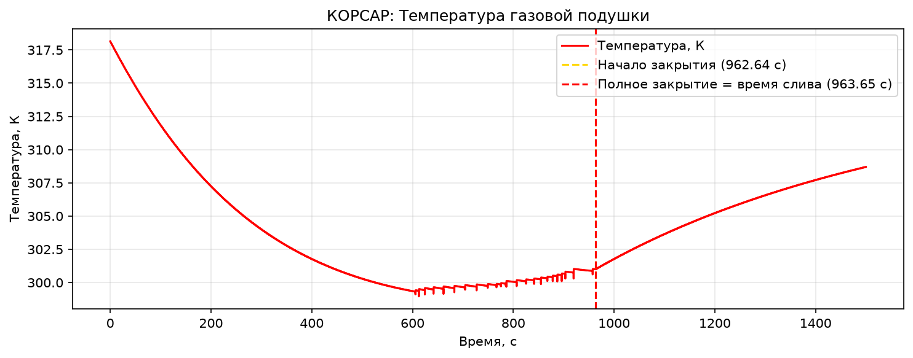

#### Результат аналитического решения
Изотермический процесс
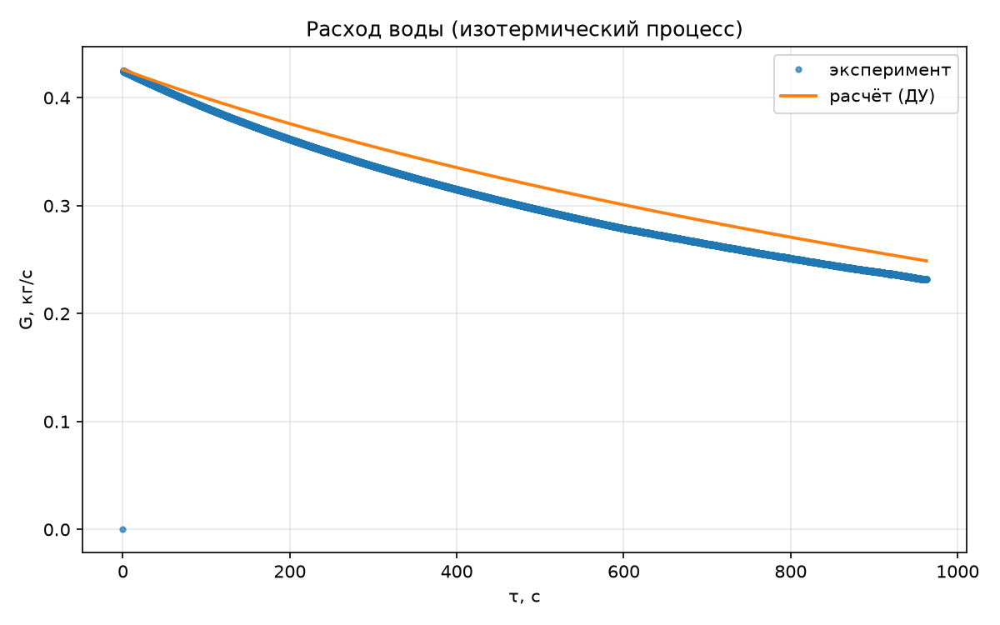
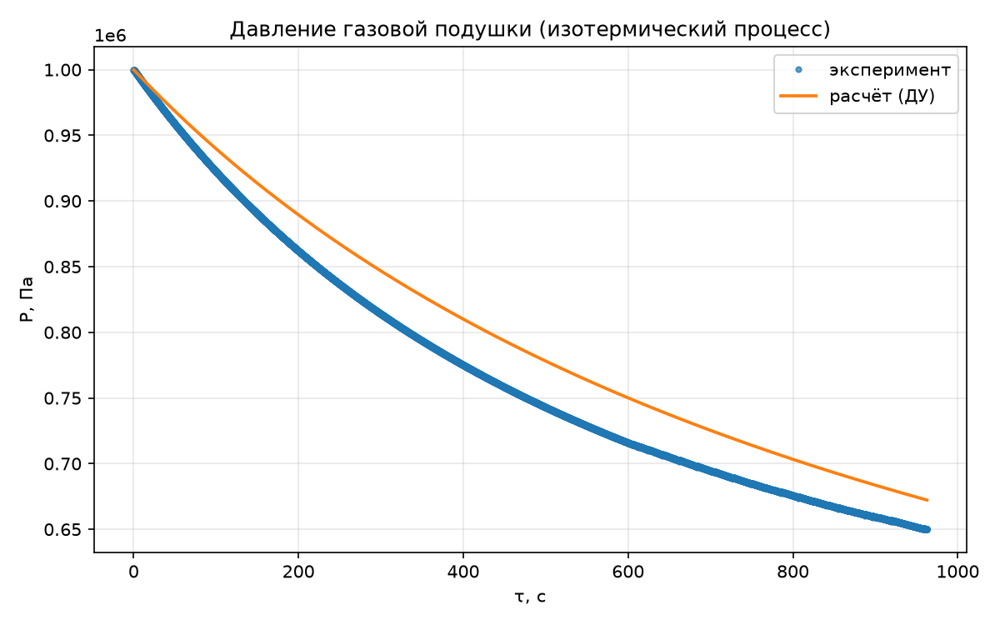
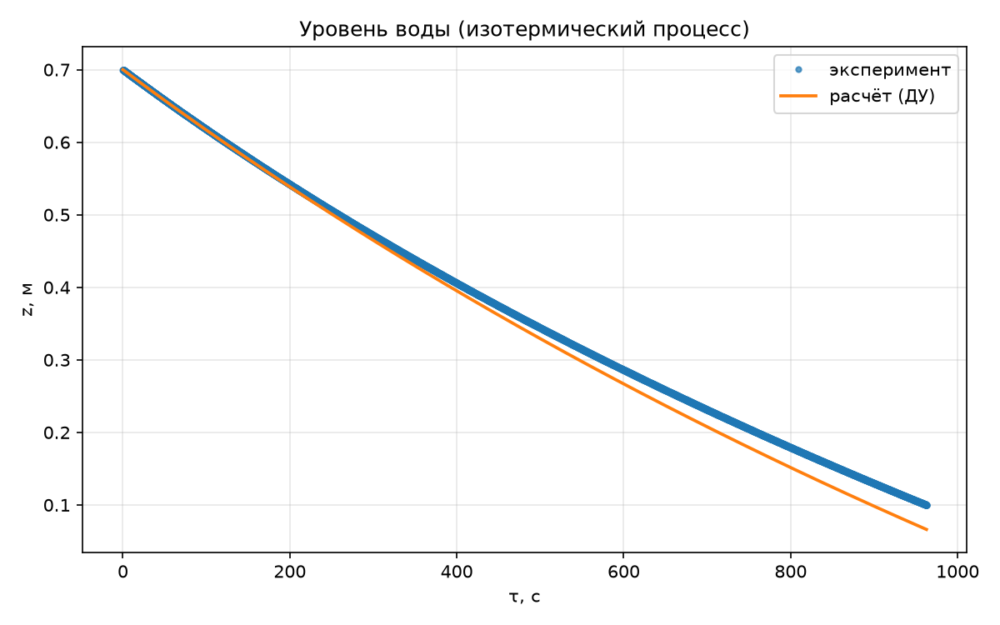
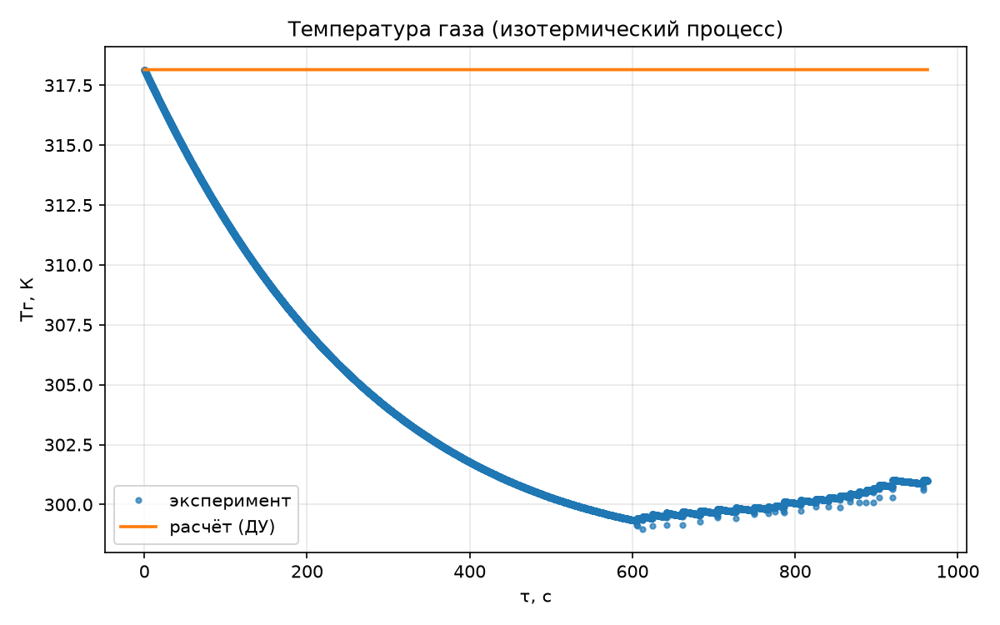

Адиабатический процесс
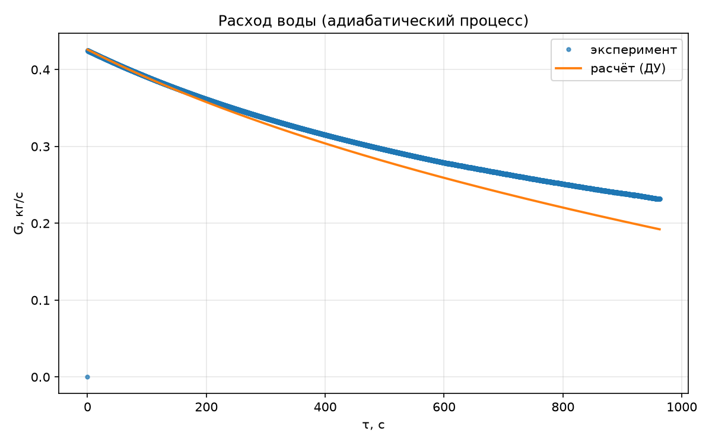
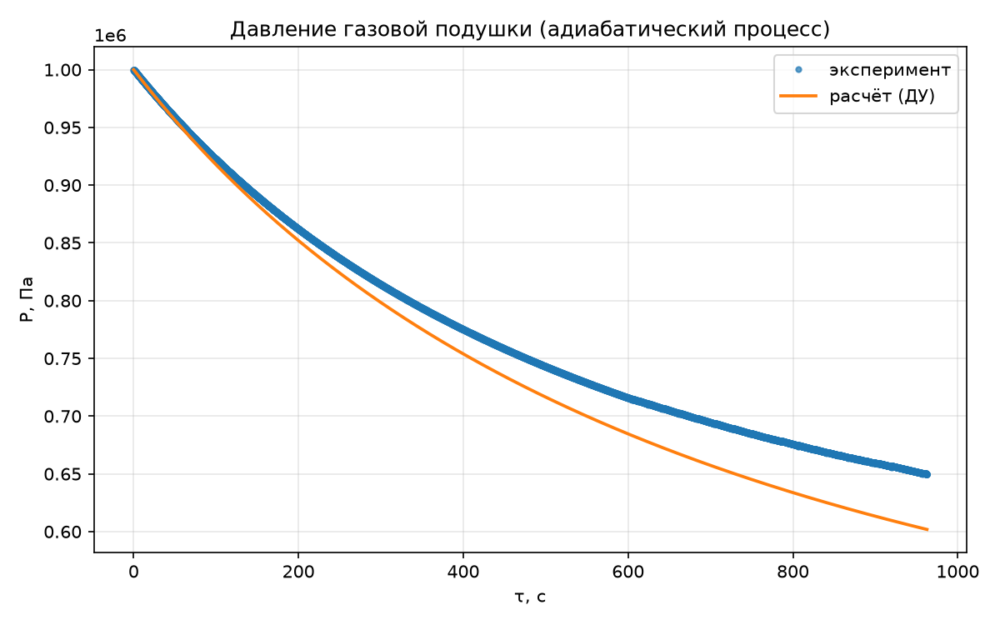
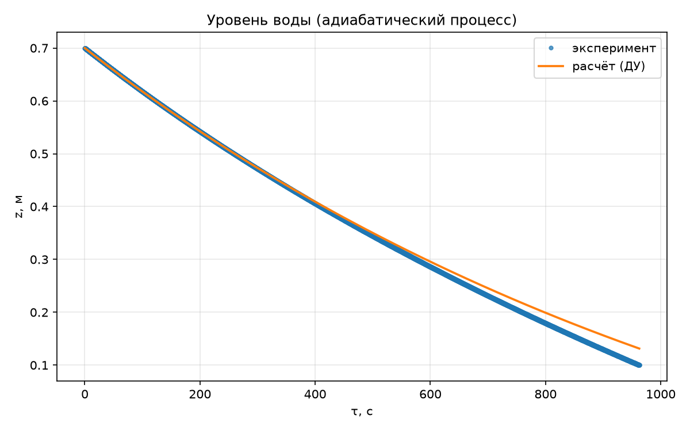
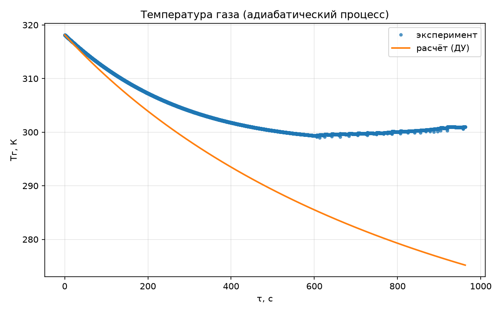

### 5.3 Сводная таблица параметров
|Параметр|Значение|
---|:---:|
|Начало закрытия задвижки|962.6400 с|
|Полное закрытие задвижки|963.6500 с|
|Длительность закрытия|1.0100 с|
|Время слива|963.6500 с (соответсвует времени полного закрытия)|
|Масса слитой воды|297.3033 к|
|Давление перед закрытием|649810.0000 Па|
|Остаточный уровень|0.099718 м|
|Невязка баланса|-1.37768e-05 м³|

### 5.4 Исследование сетки, шага времени и влияния теплообмена; объяснение различий с изотермой и адиабатой
#### Исследование сетки по каналу СН
|Число ячеек|Время слива, с|Давление перед закрытием, Па|
---|:---:|:---:|
|5|-|-|
|10 (базоая)|963.65|649810|
|20|-|-|
|40|-|-|

При переходе от 20 к 40 ячейкам результаты меняются менее чем на 1-2% - сетка сходится. Базовая сетка 10 ячеек достаточна, так как основное сопротиволение сосредоточено в VAL.

#### Исследование шага времени
|Шаг, с|Время слива, с|Примечание|
---|:---:|:---:|
|0.1|-|Возможны осцилляции в момент закрытия VAL|
|0. 01 (базоая)|963.65|	Устойчивое решение|
|0.001|-|Результат не меняется, время счета растет|

Рекомендуемый шаг — 0.01 с.

#### Влияние теплообмена
|Вариант|Поведение $T_г(\tau)$|Близость к режиму|
---|:---:|:---:|
|Без HCS (базовый)|Слабое снижение|Между изотермой и адиабатой|
|С HCS (массивный)|Почти постоянная|Ближе к изотерме|
|Чистая адиабата|$T_0 \cdot \left( \dfrac{P(\tau)}{P_0} \right)^{\frac{n-1}{n}}$|Адиабата|

Отсутствие HCS не делает подушку адиабатической: теплообмен между водой и газом на зеркале испарения и фазовые переходы сохраняются. Подключение массивного HCS усиливает теплообмен и смещает процесс к изотерме.

#### Объяснение различий с изотермой и адиабатой
Отличие от изотермы. Теплообмен на зеркале имеет конечную интенсивность. При быстром расширении газ не успевает получать тепло от воды, поэтому $T_г$ снижается - процесс уходит от изотермы. \
Отличие от адиабаты. Даже без HCS газ получает тепло от воды и участвует в фазовых переходах с водяным паром. Это отклоняет процесс от чистой адиабаты в сторону изотермы. \
Итог. При малом перепаде давлений (1 → 0.5 МПа) расширение газа умеренное, и результаты КОРСАР ближе к изотермическому режиму. Для проверки сравните $T_г(t_*)$ с адиабатической температурой $T_0 \cdot \left( \dfrac{P(t_*)}{P_0} \right)^{\frac{\gamma-1}{\gamma}}$: если $T_г(t_*)$ выше, теплообмен с водой существенен.

---
## 6. Валидация результатов расчета

как наша программа КОРСАР бъется с физикой процесса вручную

---

## 7. Список литературы
1. КОРСАР/В3. Руководство пользователя. Локальное руководство. Основное описание SLVES читать совместно с дополнениями раздела 5
2. NASA Glenn Research Center. Isentropic Compression. Вывод соотношений идеального газа при обратимом адиабатическом сжатии и расширении. Учебный материал
3. NIST. Index of Semiconductor Process Gases — Nitrogen. Идеальногазовая теплоемкость азота Таблица свойств
4. Благов Э. Е., Ивницкий Б. Я. Дроссельно-регулирующая арматура ТЭС и АЭС. М.: Энергоатомиздат, 1990. Литература к характеристикам арматуры, использованная в лабораторной 001
  
## Сокращения и обозначения
SLVES - сосуд под давлением\
CH - канал\
BVOL_T - заданная граничная ячейка\
VAL - элемент арматуры\
КГС - коэффициент гидравлического сопротивления\
ПГО - парогазовый объем\
Vt - полный объем сосуда\
Vw,Vg - объемы воды и газа\
h - уровень от дна\
Р,Рb - давление над уровнем и давление приемника\
q - объемный расход\
G - массовый расход\
Qg - подвод тепла к газу\
ζΣ - КГС всего тракта\
Ae - эффективная площадь\
n - показатель политропы\
γ = cp/cv - показатель адиабаты\
индексы 0 и * — начальное состояние и отсечка\
I и A — изотермический и адиабатический режимы